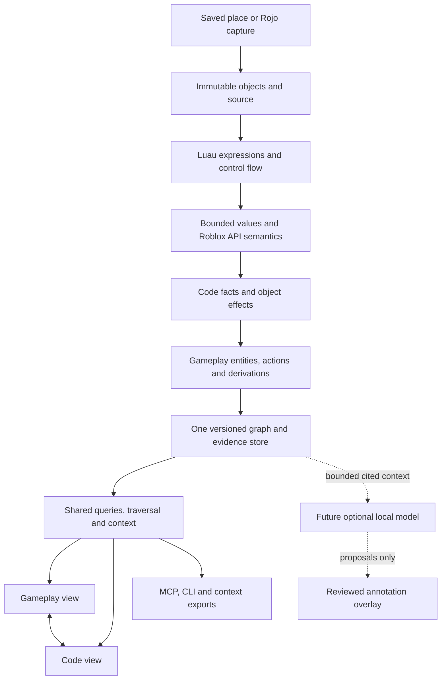

# RoGraph gameplay and code architecture

Date: 2026-10-31

Status: accepted for implementation, with the concrete-node amendment below.

User amendment: visible nodes must refer to actual project files/objects (including named objects defined by creation code). Actions are labeled connections and expandable records. Runtime allocation identity remains internal; project templates retain their actual names. Do not display invented nodes such as “Symbolic spawned egg”. This amendment takes precedence over the earlier action/actor/allocation canvas examples in this document.

Baseline: `cc62f4c` (RoGraph 0.1.0).

Supersedes the default-view, unresolved-presentation, and runtime-template analysis decisions in the [original design](2026-10-30-roblox-knowledge-graph-design.md). Other import, privacy, provenance, Rojo, packaging, and snapshot guarantees continue to apply.

## 1. Product goal

RoGraph must explain both **what the game contains and how its gameplay works**. Developers should follow a player interaction through a GUI control or world prompt, the responsible code and communication, the models/assets affected, and the configuration controlling the outcome. AI agents should retrieve the same explanation with precise supporting code and explicit remaining unknowns.

The first implementation continues to analyze saved `.rbxl` / `.rbxlx` places and optional Rojo projects locally. It does not execute imported game code. Studio observations remain a later extension. Static analysis must represent code-created objects and potential interactions symbolically rather than waiting for a Studio recorder.

The current implementation delivered useful code indexing but the wrong primary abstraction. This revision needs stronger analysis and a gameplay model, as well as different presentation. Hiding unresolved nodes alone is insufficient.

## 2. Decision: one graph, two linked views

**Recommended architecture:** retain Code and add Gameplay as the default view. Both query the same versioned, evidence-backed graph. This is the architecture proposed by the author, pending user approval.

| Approach                              | Strength                                                                          | Tradeoff / decision                                                                                             |
| ------------------------------------- | --------------------------------------------------------------------------------- | --------------------------------------------------------------------------------------------------------------- |
| Replace Code with Gameplay            | Simple main canvas                                                                | Removes valuable function/module/config inspection and precise change analysis; does not meet both stated goals |
| Put every layer on one canvas         | All information can be displayed together                                         | Recreates utility hubs and visual noise; retain only as selection-local expansion                               |
| Two linked projections over one graph | Clear gameplay overview plus detailed implementation; shared identities and proof | Requires projection contracts and cross-view selection; recommended                                             |

Two views are not two independently inferred databases. A gameplay edge opens its proof and the relevant code neighborhood. A code node can show its associated gameplay actions. Selection, analysis revision, filters, and source evidence stay consistent across the switch.

## 3. What exists and where the chain breaks

The current importer already retains saved Models, scripts, GUI controls, Attributes, properties, and config source. The source/provenance, native import, parse cache, SQLite, worker, HTTP, CLI, and read-only MCP boundaries are reusable.

Inspection of the supplied Grow a Chicken snapshot and current source found:

| Current behavior                                                                                             | Consequence                                                                                          | Owning code                                      |
| ------------------------------------------------------------------------------------------------------------ | ---------------------------------------------------------------------------------------------------- | ------------------------------------------------ |
| Binary/unary/conditional expressions lose their semantics during lowering; control-flow blocks are flattened | `attribute or default` and config-selection conditions cannot propagate                              | `packages/core/src/ast-lowering.ts`              |
| Resolution follows a small set of initializers, literal keys and concrete saved objects                      | Selected config values do not become child-name candidates; callback parameters lose object identity | `resolver.ts`, `module-values.ts`                |
| API metadata primarily identifies member names/kinds; most built-ins lack value/effect summaries             | `math.random`, `task.spawn`, property operations and clone results become unresolved                 | `api-members.ts`, `resolve-calls.ts`             |
| `workspace` is not bound to the saved Workspace service                                                      | Parenting effects lose their destination                                                             | `resolver.ts`                                    |
| No explicit action, actor-role, allocation or derived-proof model                                            | Resolved code sites cannot express complete gameplay flows                                           | `packages/contracts/src/model.ts`, `assemble.ts` |
| Default canvas hides most models/UI and retains per-site unresolved placeholders                             | The view highlights implementation noise instead of gameplay                                         | `apps/web/src/GraphView.tsx`                     |

For the supplied egg loop, the existing index resolves `GetAttribute` but reports `task.spawn` / `math.random` as `UNRESOLVED_MEMBER`, the config-driven egg lookup as `DYNAMIC_CHILD_NAME`, and later transforms as propagated unknown call results. The source is present; the analyzer loses its meaning before the viewer.

Private test games and their full source remain excluded from GitHub. Public regression fixtures must be newly authored minimal reproductions.

## 4. Canonical model and identities

Preserve existing Instance, function, field, relation, occurrence, and source IDs. Add the following concepts without duplicating saved Instances:

| Concept                                   | Representation                                                                                                                                |
| ----------------------------------------- | --------------------------------------------------------------------------------------------------------------------------------------------- |
| Gameplay entity                           | A facet on a saved Model, Tool, Part, GUI or asset anchor, or a logical group referencing concrete members                                    |
| Player / Character / PlayerGui / Backpack | Explicit runtime actor roles or per-player role paths; never fabricated saved Player Instances                                                |
| Action                                    | A node anchored to a trigger registration, scheduled callback, or effectful function summary; label can be improved without changing identity |
| Code-created object                       | A symbolic allocation/template node anchored to an `Instance.new` or `Clone` site, source revision and bounded call context                   |
| Selector                                  | A typed symbolic expression such as config row selected by `ChickenType`, including fallback and possible targets                             |
| External asset                            | A saved asset-reference identity and availability state; an asset ID does not imply its media or source has been downloaded                   |

An allocation records its template, class, creation site and symbolic parent. It represents potential instances created there, not one invented persistent copy per loop iteration. A clone's identity remains distinct from its template; mutations of the clone must not be assigned to the saved original. Clone descendants retain paths relative to that allocation and template.

Proposed contracts live in `packages/contracts/src/gameplay.ts` and `analysis-values.ts`. Existing `model.ts` gains typed facets and references to these records; arbitrary renderer attributes must not become the semantic contract. Each action has structured trigger, handler, subject, configuration, guards, scheduling, and effects associations. Pure helpers do not automatically become gameplay actions.

Deterministic IDs use canonical anchors and rule versions, not labels, source traversal order, community numbers, or display positions. Analysis identity includes the lowerer, value engine, API semantics, gameplay extractor, projection and schema versions. Cross-save matching remains explicitly separate from identity within one analysis.

## 5. Static analysis pipeline

### 5.1 Preserve the program before resolving it

Extend the existing AST lowering to retain binary/unary/conditional operators, expression lists, member access, assignment order, function parameters, and explicit basic blocks. Record branches, `return`, `break`, `continue`, loops and their guards. Keep the original AST/source and exact spans. Callback bodies are analyzed as their own functions, with the scheduling/registration site retained.

This is a bounded intermediate representation for relationships, not an interpreter. Imported Luau is never evaluated. Previously conservative mutation/alias checks remain required.

### 5.2 Shared bounded abstract values

Replace loosely shaped value objects incrementally with a tagged value domain: literals and nil, finite alternatives, table references/fields, saved Instance references, typed runtime roles, allocation references, symbolic property/Attribute values, functions, engine intrinsics, selectors, and unknowns with reasons.

Value evaluation returns `{ value, support, guards, completeness }`; finite target sets preserve which config row and guard produced each target. Join points keep correlations, preventing a Standard config's egg template from being paired with another variant's scale. `or` follows Luau truthiness (only nil/false are false), and a missing key can reach its fallback. Optional object results retain nil until a guard refines them.

Initial defaults: at most 32 finite alternatives, 4 call-summary contexts per function, and call depth 8. Loops converge using widening after 3 changing visits. Every widening and limit records an explicit incompleteness reason; retain known targets plus an unknown remainder rather than silently discarding targets. These are configurable engineering defaults to validate against the existing 16 GB machine, not performance promises.

Model local assignments and effects in order; join branches and widen loops. Summarize functions by parameters, returns, callbacks and object/config effects. Propagate known arguments into local calls and registered callbacks using bounded contexts; handle recursion via a worklist and conservative summaries. Unknown writes/escapes invalidate affected literal/table assumptions. Do not reuse cached syntax or summaries across incompatible versions or bindings.

### 5.3 Versioned platform semantics

Add a small, testable semantics registry separate from name/reflection metadata:

- Luau libraries (`math`, `string`, `table`, `coroutine`, etc.) and common globals: recognized engine/library operations, not missing project packages. Numeric randomness can remain symbolic while the call itself is recognized. Respect local shadowing and reassignment of globals/libraries. [Luau standard library](https://luau.org/library/).
- Roblox globals and types: `game`, `workspace`, `Enum`, `Instance.new`, `CFrame.new`, `Vector3.new` and related constructor/type results.
- `task.spawn`, `defer`, `delay`, `wait`: callback scheduling and timing dependencies, without inventing a guaranteed execution order. [Roblox task API](https://create.roblox.com/docs/reference/engine/libraries/task).
- Instance lookups with literals or bounded name alternatives, Attributes/Value objects, `IsA` refinements, parent/child paths, `Clone`, `Destroy`, `GetChildren`/`GetDescendants`, tags and property access. Preserve optional returns and cloning restrictions such as `Archivable`; unavailable results remain conditional. [Roblox Instance API](https://create.roblox.com/docs/reference/engine/classes/Instance).
- Model transforms (`PivotTo`, `ScaleTo`), Part transforms/size, parenting and destruction as typed effects. A property read provides data; a property write or a documented effectful method changes a target. Neither implies arbitrary interaction with every referenced object.
- Signal callback parameter signatures, player roles, ProximityPrompt / ClickDetector / Tool / GUI entry points, and remote/bindable send-to-handler argument binding. Match channels by resolved identity and retain client/server boundaries.

Known platform calls may appear as intrinsics in Code details, but do not become gameplay dependency hubs. Unsupported engine behavior retains a typed result where justified, plus an unsupported-effect diagnostic. Recognition does not authorize guessing the effect.

## 6. Required explanation for the egg-laying example

The analyzer must build this supported chain:

1. Anchor `chicken` to the script's containing model or to the model parameter supplied by a known caller. Attribute reads reference that entity.
2. Represent `ChickenType or "Standard"` as a selector. A saved Attribute is an initial value, not an immutable runtime constant. Preserve unknown runtime changes unless writes and scope prove a bounded value.
3. Follow the required `ChickenConfig` table, its selected row and the `Standard` fallback. Keep `EggTemplateName`, interval, and scale fields attached to the corresponding row.
4. Use finite `EggTemplateName` alternatives to look up ServerStorage templates. If selection remains open, show the known templates as conditional alternatives plus an unknown remainder. Do not choose a template from name similarity.
5. Associate `Clone` with that template and a symbolic new egg; apply `Model` / `BasePart`, root-part, nil and `continue` guards. The spawned object can be a Model or Part; model-only assumptions must not drop the Part branch.
6. Record placement from the chicken root, scale from the selected config, and parenting into Workspace. Associate the scheduled repeating action with config-controlled timing. No exact random value or number of eggs is claimed.

Default gameplay explanation: **Chicken → lays egg action → Egg template / spawned egg**, with **ChickenConfig → configures action** and an expandable **Chicken → configured by ChickenConfig** association through the controller's verified reads. The physical chicken root and egg transforms appear in the action's expanded effect details.

When selection is conditional, the main action remains visible with its guards. Failure to know the eventual runtime ChickenType must not erase the supported model/config/action relationships. Every hop must open the corresponding owner binding, require/config selection, lookup, clone, transform, and parent-write evidence.

## 7. Gameplay extraction and proof

Run extraction after shared value/effect analysis. Proposed modules: `packages/core/src/gameplay/entities.ts`, `actions.ts`, `derive.ts`, and `proof.ts`.

Use a compact directed vocabulary with documented endpoints:

| Relation                                        | Meaning                                                                                                |
| ----------------------------------------------- | ------------------------------------------------------------------------------------------------------ |
| `CAN_TRIGGER`                                   | An actor role can activate a specific action through its supported trigger                             |
| `TRIGGERS`                                      | A control, signal or channel starts a particular action/handler under its guards                       |
| `IMPLEMENTED_BY`                                | Action → owning script/function                                                                        |
| `TARGETS`                                       | Action → object that an effect actually uses or changes                                                |
| `READS_CONFIG`                                  | Action → specific config field/selector                                                                |
| `CONFIGURES`                                    | Config → action, derived from its verified reads; this is configuration influence, not execution order |
| `CONFIGURED_BY`                                 | Entity → config through a controller action proven to operate on that entity                           |
| `SPAWNS`, `TRANSFORMS`, `DESTROYS`, `TRANSFERS` | Action → affected allocation/object, with method/property and guards                                   |
| `CLONED_FROM`                                   | Symbolic allocation → saved/symbolic template                                                          |
| `LOCATED_USING`                                 | Placement effect/allocation → source object/property supplying position                                |

Keep ownership, causal flow, configuration influence, data dependence and template identity distinct. `TARGETS` alone is not proof of mutation; use the effect record. A shared utility, shared config read, common ancestor, same name or community membership never establishes a gameplay action between entities.

Existing direct `Evidence` keeps its single source-span or saved-property locator and owning relation. Add `Derivation` records for semantic edges: rule/version, supporting relation/evidence/site IDs, ordered witnesses, guards, completeness and assumptions. Validate that supports exist in the same analysis and the derivation graph is acyclic. Derived relations must not relabel an unrelated evidence record as their own direct proof.

Derivation precision is separate from execution: a statically resolved relationship is still potential behavior. Preserve saved/resolved/candidate/unresolved statuses for source resolution, and use separate fields for origin (`direct`, `derived`, future `model-proposal` / `human-annotation`) and execution evidence (`static`, future `observed`). A model proposal cannot acquire deterministic status by being displayed or accepted as an annotation.

## 8. Interaction coverage beyond eggs

Required authored fixtures include:

- **Chicken pickup:** Player role → saved prompt → pickup action → handler → clone ChickenItem into Player.Backpack and destroy physical chicken. Keep giving a tool and removing a model as separate effects.
- **Egg pickup:** callback parameter from a descendant traversal/name-and-class guard → dynamically created prompt → Player trigger → EggTool clone/backpack transfer → egg destruction. Match the filtered object set; do not bind the handler to every Workspace descendant.
- **GUI flow:** Player → concrete/template button → click/activation handler → exact remote → compatible server callback → verified player/model effect. Distinct remotes and per-player role paths must remain separate.
- **Automatic actions:** scheduled egg laying and other recurring model behavior exist without a player trigger.
- **Config reuse:** two models may read the same config while having no direct interaction. Show the config association, never a fabricated model-to-model action.

Display labels such as “Pick up egg” come from action/effect rules and explicit prompt text where available. Names/comments may help navigation and future suggestions; they are not sufficient causal proof.

## 9. Projection and human workflow

Create projections in the shared core (`packages/core/src/projection.ts`), not inside React. Proposed query fields: `view: "code" | "gameplay"`, `expandedIds`, and `includeIntrinsics`. Preserve existing operations and make `view` optional with **code as the API compatibility default**; the updated UI explicitly requests gameplay. Agent capability discovery advertises both and recommends selecting a view intentionally.

Gameplay shows actors, interactive UI, meaningful models/assets/templates, actions, and config associations. Unconnected saved objects stay reachable through hierarchy/search and an explicit unconnected-assets filter. Model contents such as geometry, attachments and welds collapse under their parent, with relevant physical parts exposed on expansion. Code continues to show scripts, methods, fields, packages, and dependencies, with platform details available on demand.

Repeated objects group only when their template/type equivalence is supported; matching names alone is insufficient. Proposed default: expandable groups for substantiated copies, distinct groups for known config variants. If equivalence is unknown, retain separate objects or mark a suggested group explicitly. UI grouping never merges canonical identities or creates causal edges.

Projection results include canonical nodes/relations plus separate visible items with member IDs, backing relation/derivation IDs, and omission counts. An aggregated visual edge has a projection identity and can open every backing occurrence. It never pretends to be an arbitrary single canonical relation. Group membership is paginated; expansion obeys existing node/evidence limits.

Replace the `details` switch with Gameplay / Code controls and selection-local “Show implementation” / “Show gameplay role”. Preserve the selected canonical anchor between views. The inspector explains trigger, guards, config selection, effects, supporting code, and unresolved portions. Graph and trace requests use the same view policy and filters.

## 10. Unknowns and coverage

Unresolved relationships should be exceptional for supported common idioms, without pretending arbitrary runtime behavior is statically decidable. Fix classification and value propagation before measuring improvement.

Classify sites separately as recognized platform operations, statically resolved project references, symbolic runtime values, conditional target sets, missing input/external source, ambiguous identities, unsupported analysis, parse/import failure, or exhausted analysis budgets. Symbolic Player and finite config selectors are useful representations, not generic unresolved nodes.

Remove per-site unknown placeholders from the default gameplay canvas. Attach scoped badges to the affected action/entity; retain a searchable, paginated diagnostics view with stable diagnostic IDs, exact sites, candidate targets and reason-specific explanations. Missing semantic targets remain visible as explicit gaps in the affected flow. Hiding a node never changes its diagnostic count or source-resolution status.

Change the source panel heading to **Saved source excerpt** and show **Relationship resolution** separately. A saved excerpt proves what text was imported, not that a dependency was resolved. Highlight the narrow failing callee/key/binding, such as `task.spawn` or `config.EggTemplateName`; keep the enclosing callback as expandable context. One unresolved call must not visually label its whole callback as incomprehensible.

Report raw counts with stable denominators, platform recognition, project-reference resolution, and gameplay-action support separately. Publish before/after reason counts for the same private games and versions. Do not claim better analysis merely because built-ins were excluded from a denominator or placeholders were hidden. Partial import and processing completion remain separate states.

## 11. AI-agent queries and context

Extend the existing shared query schema, HTTP, CLI, MCP and JSON/Markdown export together. Gameplay `overview`, `inspect`, `trace`, `impact`, and `dependencies` return semantic records, canonical support, conditions and coverage. Add `explain` for an action/entity and `implementation` for its code witnesses; a trace goal distinguishes interaction flow from config influence and dependency paths.

An action context bundle contains: actors/triggers; ordered handler/channel flow; model/template targets; relevant config rows/fields; concrete effects; guards/unknown remainder; exact source citations; supporting proof IDs; and omissions. Pack a complete minimal witness and its critical uncertainty before peripheral neighbors. If budget prevents a full witness, label it incomplete and provide stable IDs for follow-up retrieval. Never export a concise confident statement whose qualification was dropped to save tokens.

Traversal is policy-driven. Gameplay flow follows supported triggers, callbacks, compatible channels and effects; config influence follows explicit config/effect dependencies. Code dependencies retain their existing direction semantics. Containment, grouping and common utility nodes are excluded as flow shortcuts. Config associations remain available without implying that everything sharing a config can trigger everything else.

Keep existing hard query ceilings (depth 6, nodes 1,000, evidence 5,000, context 32,000 UTF-8 bytes) unless a separately measured change justifies revision. Preserve boundary/omission metadata. All queries pin `analysisId`; source data is untrusted project content, never instructions to the consuming agent.

## 12. Storage, migration, and integration boundaries

Add transactional SQLite schema migrations from user version 1. Store facets, actions, effects, derivations and scoped diagnostics with analysis ownership and indexed anchors/adjacency. Save code and gameplay results atomically with the same source/input hashes. Do not publish a new analysis if semantic validation fails; an inspectable partial analysis must disclose its failed stage.

Existing analyses remain readable in Code mode. Advertise `gameplayAvailable: false` until explicit reanalysis produces a new immutable analysis; do not mutate old facts or imply that old files were analyzed with new rules. Retained raw inputs can support reanalysis; missing/unreadable retained input produces a clear request to select the file again. Rojo reanalysis must use a consistent captured revision rather than mixing current files with old sourcemaps.

Retain native import/parser boundaries and the current optional pinned Rojo adapter. Rojo supplies project/object/file mapping, not gameplay causality. A language server can later enrich supported typing only after fixture validation; it is not a substitute for clone/effect/action analysis. No new graph server, hosted service, model API, or wholesale importer rewrite is needed.

## 13. Future update: optional local model and weights

Reserve a provider-neutral `SemanticAssistant` boundary that consumes bounded, cited read-only graph context and produces schema-validated **proposals**. The deterministic analyzer and both views work without a model installed.

Future functionality: categorize remaining analysis gaps, propose entity/system groups, suggest action labels and candidate links, and explain why a dynamic pattern needs a new resolver rule. A local agent may perform bounded retrieval/iteration through read-only queries, but it receives no shell, filesystem-write, imported-code execution, or game-mutation capability.

An implementation candidate is a separately managed local runtime such as `llama.cpp` with user-selected compatible weights and constrained structured output. Its server supports schema-constrained JSON, but this constrains format, not factual correctness. [llama.cpp server documentation](https://github.com/ggml-org/llama.cpp/blob/master/tools/server/README.md).

Model packages must record runtime version, model/quantization ID, weight hash, license/redistribution terms, resource requirements, and prompt/schema version. Weight installation is explicit and separate from the base app; no automatic multi-gigabyte download or cloud fallback. Choose model size and CPU/GPU settings only after accuracy, latency, RAM/VRAM and licensing evaluation on the user's hardware. Selecting or downloading a model is outside this update.

Store proposals in a separate overlay keyed by analysis, evidence hashes and model provenance. Require valid existing IDs and citations; reject malformed/stale proposals. Cite the evidence and the reasoning gap; a cited snippet alone does not establish entailment. Keep `suggested`, `accepted annotation`, and `rejected` decisions separate from deterministic facts. Human acceptance can improve organization or preserve a manual mapping, but does not silently make a guessed link statically resolved. Revalidate or mark annotations stale after relevant source/template changes. Report proposal precision/abstention independently of analyzer coverage.

Later Studio observations attach to exact revisions and explicitly observed object/action records; a recording confirms observed instances/events and does not prove all possible behavior. Neither local models nor Studio capture is a prerequisite for the egg-loop improvements.

## 14. Delivery sequence and file responsibilities

Each phase has an independently reviewable result. Use the previously selected **Native** execution approach: primary implementation, targeted verification, one independent final review. This document is an architecture/delivery plan; detailed executable tasks follow approval.

| Phase                               | Deliverable and primary files                                                                                                                                                                                                       | Acceptance gate                                                                                                                                                                                                       |
| ----------------------------------- | ----------------------------------------------------------------------------------------------------------------------------------------------------------------------------------------------------------------------------------- | --------------------------------------------------------------------------------------------------------------------------------------------------------------------------------------------------------------------- |
| 1. Capture intended behavior        | New authored `fixtures/gameplay/` reproductions; `tests/gameplay/egg-flow.test.ts`, `pickup-flow.test.ts`, `gui-flow.test.ts`, `no-false-links.test.ts`; baseline report script                                                     | Expected entities, actions, targets, conditions and evidence recorded; demonstrate current failures without uploading private games                                                                                   |
| 2. Values and platform semantics    | New `contracts/src/analysis-values.ts`, `core/src/analysis/{ir,values,flow,summaries}.ts`, `core/src/semantics/{luau,roblox,callbacks}.ts`; modify `ast-lowering.ts`, `resolver.ts`, `module-values.ts`, existing resolution passes | Built-ins/Workspace recognized; fallback/variant config lookup, callbacks, optional targets and clone identity pass focused regressions; prior conservative mutation tests still pass                                 |
| 3. Gameplay facts and persistence   | New `contracts/src/gameplay.ts`, `core/src/gameplay/{entities,actions,derive,proof}.ts`, `core/src/migrations.ts`; modify `model.ts`, `assemble.ts`, `schema.sql`, `store.ts`, worker/pipeline wiring                               | Egg/chicken/GUI flows have supported derivations and stable IDs; complete save/reopen parity; version-1 Code compatibility and reanalysis capabilities tested                                                         |
| 4. Shared views and agent retrieval | New `core/src/projection.ts`, gameplay traversal policy; modify contracts `query.ts`, core `query.ts`, `traversal.ts`, `grouping.ts`, `context.ts`, local `mcp.ts`, `cli.ts` and shared HTTP handling                               | Same projection/proof across UI API, CLI and MCP; no utility/config-sharing causal shortcuts; budgeted context retains critical conditions                                                                            |
| 5. Human exploration                | Modify web `App.tsx`, `GraphView.tsx`, `Inspector.tsx`, `SourceView.tsx`, `DiagnosticView.tsx`, trace/filter/context components; new focused view/action components as needed                                                       | Gameplay default, Code preserved, cross-view selection, model/group expansion, prompt/button chains, specific unresolved highlighting and scoped diagnostics work in browser tests                                    |
| 6. Real games, review and release   | Private validation tooling; public aggregate `docs/provided-game-validation.md`, user/agent guides, release notes and package scripts where versions change                                                                         | All three local games reanalyzed; sampled real action proofs checked; reason-count comparisons and remaining gaps reported; targeted performance/reopen/portable package checks and final independent review complete |
| Future A. Local assistant           | Separate model adapter/runtime manager, proposal schema/store/review UI and evaluation fixtures                                                                                                                                     | Optional install, offline operation, malformed/stale proposal rejection, provenance, resource cancellation and no promotion of unsupported suggestions                                                                |
| Future B. Studio capture            | Revision-matched plugin/observation adapter                                                                                                                                                                                         | Observed facts remain separate from static potential behavior; no mixed-revision proof                                                                                                                                |

Resolve interface/fixture decisions in the detailed implementation plan before Phase 2. Avoid maintaining a second independent resolver: existing code-reference passes must consume the shared value/summaries engine as it is introduced.

## 15. Verification and success criteria

The mandatory authored fixtures must demonstrate the entire egg-laying example, both pickup flows and a GUI-to-server effect, with a navigable witness for every expected relation and no generic unresolved diagnostic for supported platform calls. They must also prove:

- nil/false versus truthy fallback; missing config keys; unknown and changing ChickenType; multiple variants; config mutation/escape and missing templates;
- shadowed/reassigned `math`, `task`, `workspace` and constructor bindings; pure platform operations do not become gameplay hubs;
- cloned versus original model mutations; non-Archivable/missing clone targets; Model versus Part branches; early `continue`; dynamic prompts and filtered descendants;
- distinct same-named objects/remotes, separate player role paths, unmatched callbacks and client/server boundaries;
- no invented link from names, common ancestors, shared helpers/config, unsupported framework dispatch or a model proposal;
- deterministic reruns, recursion/alternative-budget exhaustion, cancellation, partial analysis, database migration/reopen and unavailable old-snapshot gameplay;
- complete proof/conditions through grouping, cross-view inspection, agent export and truncation.

Measure quality with an explicit expected-relation fixture set (required positives plus forbidden links), platform recognition and reason-specific resolution counts. All required authored links must be present with correct support; all forbidden links must be absent. For the private games, review and report supported versus missing chains without claiming a universal completeness percentage. Preserve original input hashes and keep private source out of commits.

Re-run existing type checks and affected unit/integration/browser suites; perform full regression and portable-package verification at the release gate. Measure cold analysis, bounded gameplay overview/trace/context, UI first render and peak memory on the existing synthetic workload and supplied games. Compare with the recorded baseline, disclose misses, and keep analysis/query work off the UI thread. This architecture makes no new performance guarantee before measurement.

## 16. Decisions for review

Proposed defaults are: two linked views with Gameplay initially selected in the UI; API omission of `view` retains Code compatibility; grouping only when template/type evidence supports it; runtime roles and allocations are explicitly symbolic; inference uses deterministic supported rules before any model; local weights and Studio capture remain optional future work. No product code, dependencies, weights or user-game content are changed by this proposal.
