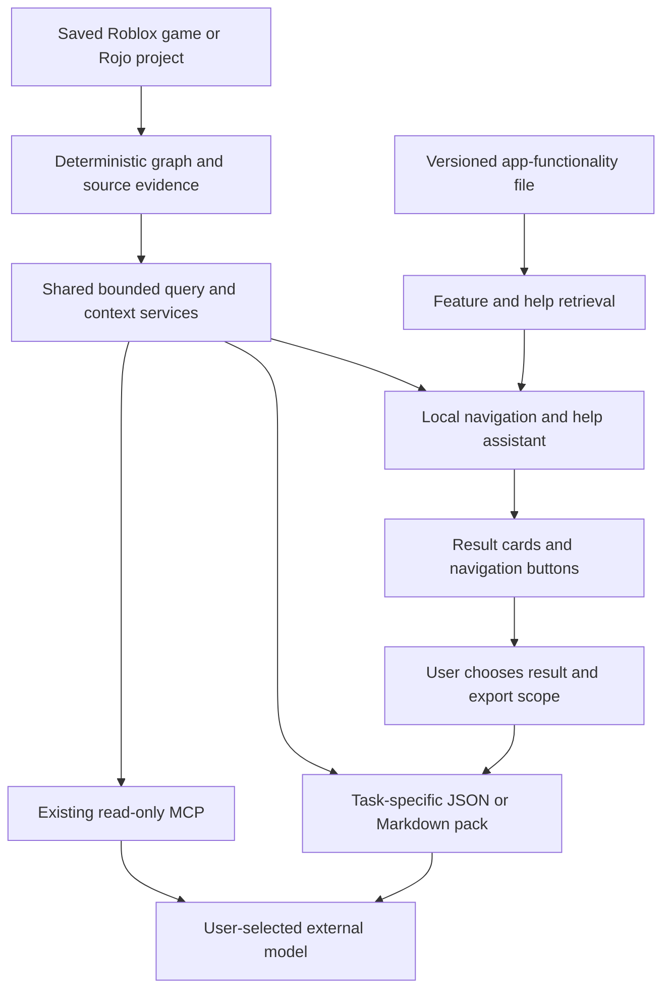

# RoGraph chatbot: graph navigation and application help

Date: 13 November 2026  
Revision: 3 — adds approved model selection, hardware-aware CPU/GPU execution and floating draggable chat.
Status: approved for implementation on 13 November 2026; progress and actual validation are tracked in the implementation plan and validation report.
Repository: [AngAndrei/RoGraph](https://github.com/AngAndrei/RoGraph)  
Inspected baseline: `fd05837146b612fdba4dab71cf90926cee41145c` (RoGraph 0.2.0).  
Required implementation branch: **`chat_bot_RAG`**, exactly, without any prefix or the word `codex`.

## 1. Intent, scope and decisions

RoGraph's primary asset is its deterministic, evidence-backed knowledge graph. Developers and external foundation models can use it to locate relevant game structure and code without repeatedly reading an entire saved game. The in-app assistant is a convenient natural-language interface to that asset and to the app's controls.

The assistant has two responsibilities:

1. **Navigate the selected game:** find nodes and connections, resolve names, follow a supported path, inspect a local neighborhood, and locate the source evidence or configuration behind a result. Give short factual explanations of retrieved results.
2. **Find and explain app functionality:** match a developer's goal to an implemented command or feature and explain the required steps, availability and limitations for the installed version.

Deep game understanding, architectural reviews, extensive code reasoning, planning changes and writing game code belong to the external model chosen by the developer. The local assistant may help select evidence for those tasks. It is not required to understand the whole game before it can find an object, and it must not scan or summarize the whole game for every question.

The user already selected **a local model downloaded on first use**, followed by offline operation. Graph analysis, manual navigation, context export and the existing read-only MCP service must work independently of that model. No in-app cloud-provider integration, account, API key or recurring inference bill is part of this feature.

Revisions from the first proposal:

| Area | Revised decision |
| --- | --- |
| Local model role | Intent interpretation, entity disambiguation, feature discovery and concise grounded replies |
| Model selection | A catalog offers 0.8B, 2B, 4B and 9B; 2B is the initial local test pack, while users choose based on hardware | 
| Retrieval | Deterministic graph tools plus lexical retrieval initially; optional compact semantic search only where measured useful |
| App knowledge | One authoritative, maintained file: `docs/app-functionalities.json`, packaged with each release |
| External models | Preserve direct MCP access; allow the user to prepare bounded raw evidence from helper results |
| Heavy work removed | Mandatory whole-game source embeddings, global semantic summaries and game-loop interpretation |
| Success metric | Correct node/connection/path and feature selection, source integrity, low latency and useful exports |

Proposed defaults retained: read-only data access, navigation after a user clicks an action, English as the first evaluated language, workspace-local conversation history with deletion/no-history controls, and a Windows CPU laptop as the reference test device. Model size and latency remain empirical release decisions.

### Approved implementation additions

- GitHub receives code, the maintained functionality file and a pinned catalog only. Model weights/runtime assets remain ignored local downloads; the feature stays on chat_bot_RAG and is not merged into main.
- Each developer can install/select a weaker 0.8B pack, balanced 2B, more capable 4B or larger 9B pack. Show exact bytes, RAM guidance, installation progress and cancellation. Keep explicit selection; never silently replace a user model.
- Probe the installed runtime for compatible GPU devices; expose Auto, CPU and GPU preference. Auto attempts compatible GPU offload and reports any CPU fallback. CPU remains available when drivers/devices are unsupported. Hardware recommendations are guidance, not a promise that weights fit or run quickly.
- The development machine gets an installed model for real local testing, outside Git. The portable local app may share that local model directory; distributed ZIPs still contain no weights.
- A fixed small robot-head button sits at the lower right. Expanded chat is a floating draggable window, moved by its header, clamped within the viewport and usable on narrow screens. Keyboard controls provide an alternative to dragging.

## 2. Existing code and integration points

This proposal is grounded in the current checkout.

| Existing component | Observed capability | Use in this feature |
| --- | --- | --- |
| `native/rbx-import`, `native/luau-parser` | Saved place/Rojo import and static analysis | Continue creating the graph independently of any model. |
| `packages/contracts/src/model.ts`, `gameplay.ts` | Nodes, canonical relations, evidence, guards, status, contexts, source hashes and spans | Preserve identities and qualifiers in chat cards and exports. |
| `packages/core/src/store.ts`, `schema.sql` | SQLite snapshots, relationship indexes and FTS5 node-label search | Reuse exact search/traversal; add only necessary bounded lookup/index selectors. |
| `packages/core/src/query.ts` | Search, inspect, source, dependencies, impact, trace, overview, coverage, diagnostics, tree, explain, implementation | Compile narrow assistant requests into these existing operations. `explain` aliases inspection; it does not currently generate prose. |
| `packages/core/src/context.ts` | Bounded JSON/Markdown evidence packs with unknowns and omissions | Reuse deterministic evidence selection; export canonical results rather than the helper's prose. |
| `apps/local/src/mcp.ts` | Read-only external-agent tools with explicit analysis IDs | Keep usable without the helper model; share underlying services, not a nested internal MCP session. |
| `apps/web/src/ContextExport.tsx` | Current-view export with budget selection and JSON/Markdown download | Add an explicit export scope for a selected chat result and a lean export representation. |
| `apps/local/src/server.ts` | Loopback service with session, Host/Origin and CSP checks | Put assistant endpoints behind the same protections. |
| `apps/web/src/App.tsx`, `api.ts` | Selected analysis, view, filters, node/relationship selection and source navigation | Send bounded UI context and connect typed, validated navigation actions. |
| `docs/user-guide.md`, `troubleshooting.md`, `agent-setup.md` | Existing app instructions | Seed the functionality file from reviewed current behavior. |
| `apps/web/src/node-annotations.ts` | Personal names/highlights in browser localStorage | Pass relevant aliases as UI hints, without changing canonical game names. |
| Launcher/build/package scripts | Portable Windows runtime and owned process cleanup | Package the helper runtime and functionality file; manage model process lifetime. |

Important limits: the normal overview is capped at 300 nodes, other queries are bounded, and context packs have a 32,000-byte hard cap. Search must cover the selected snapshot rather than only the canvas. Existing label FTS is not project-wide source-body search. Source Find searches one selected retained source.

Saved/static potential behavior is distinct from runtime observation. The current app cannot establish yesterday's execution count, a complete live game state or dynamic behavior that its analysis did not resolve. This remains true whether a small local model or a powerful external model reads the graph.

## 3. Recommended approach and alternatives

Use **tool-assisted RAG**: retrieve canonical graph results and maintained feature documentation, then present them as cards with optional short model-generated wording. Retrieval augmentation does not require embedding every source file. Exact/lexical search and graph traversal are valid retrieval channels.

| Approach | Tradeoff | Decision |
| --- | --- | --- |
| Large local assistant that reads and interprets the whole game | Larger download, slower prompts and unnecessary responsibility for this role | Exclude from this feature. |
| Small unrestricted tool agent | Easy prototype, but an unreliable model can loop, choose wrong tools or invent unsupported results | Use a controlled workflow and typed plans instead. |
| Small intent interpreter + deterministic operations + maintained feature file | Compact prompts, testable navigation and predictable scope | **Recommended.** |
| Full vector/source/community-summary pipeline | Can assist broad semantic exploration, but adds indexing/runtime work before it is needed | Defer broad source embeddings and global summaries. |

A smaller model still needs to choose the right operation and distinguish similarly named objects. Do not select the smallest model just because its parameter count is attractive. Select the smallest candidate that passes the navigation/help reliability gates in section 15.

Token savings for external models are an objective to measure, not an assumed property of the graph format. A small task-specific subgraph can save input, while dumping every node, evidence record and source into JSON can be more expensive than a few targeted source reads. Live Roblox MCP may also expose information a saved-file graph lacks; it remains complementary where fresh runtime evidence is needed.

Keep the one-time local download choice. External model handoff means user-controlled export or an external MCP client, not hidden cloud escalation inside the app.

## 4. Data flow and responsibility split



The backend owns graph identities, scope, traversal and evidence selection. The model interprets the request and may compose a short response. External models consume the shared query/evidence services directly; they never depend on a summary generated by the small local model.

Process placement:

- Existing Node service: authenticated API, small orchestration state machine and model-process manager.
- Existing graph worker: current graph queries and validated additional selectors.
- One assistant data worker: compact feature/entity/connection indexes and workspace-local chat persistence in `assistant.db`.
- One lazily loaded app-owned llama.cpp generation process, with a pinned Windows CPU build. No Python, Docker or separately installed Ollama requirement.
- An embedding worker/runtime only if semantic retrieval is selected after the comparison in section 7. It is not a baseline dependency.

Do not introduce internal multi-agent conversations, a second graph database, or a standalone vector service. The installed assistant model can be off while export/MCP remains fully available.

## 5. Revised model research and selection

Research checked on 13 November 2026 using publisher model cards and runtime documentation. Models have not been benchmarked in RoGraph. Task reliability, quantized CPU latency, distribution terms and download/memory cost take precedence over general game/code reasoning scores.

| Candidate | Verified characteristics | Revised role |
| --- | --- | --- |
| **Qwen3.5-2B** | 2B language model with optional vision components; Apache 2.0; documented tool use and reasoning configuration [S11] | **First candidate to evaluate for the standard local pack.** Use text only, a 4-bit GGUF build and non-thinking mode; require strict navigation/help evaluation. |
| **LFM3-1.7B** | 1.73B text model aimed at local agents, tools and structured outputs, with GGUF support; custom LFM Open License [S6] | Strong small candidate for this narrower role. The previous exclusion based on deep code reasoning no longer applies; test template/output behavior and assess distribution terms before selecting it. |
| **Granite 4.2 3B** | Dense 3B; Apache 2.0; configurable thinking modes and tool calling [S2] | Reliability challenger if the smaller candidates fail to select features/entities consistently. Verify the exact GGUF/runtime combination. |
| **Qwen3.5-4B / Qwen3-4B-Instruct-2507** | Apache 2.0; documented tool use; the latter is a non-thinking-only checkpoint [S1], [S3] | Quality/compatibility reference or fallback, rather than the default size. |

Offer approved 0.8B, 2B, 4B and 9B text model packs; no weights ship with GitHub source or the default release. Multimodal assets remain excluded. Gemma's effective-parameter naming alone is not a footprint comparison, so it is not a priority experiment for this narrow first release. The earlier larger-model research remains background, not a delivery requirement.

Candidate caveats matter: Qwen's 2B card frames its intended use around prototyping/task-specific development and documents thinking-loop risks [S11]. LFM's card notes that disabling reasoning can be inconsistent [S6], and its license has commercial-use conditions [S12]. These do not establish poor navigation performance, but they rule out assuming that either is a drop-in production solution. Benchmark the actual non-thinking/grammar/template/quantization combination. If it fails, use the next candidate or retain deterministic results while revising the recommendation.

### Selection method

1. Test Qwen3.5-2B and LFM3-1.7B on intent interpretation, slots/endpoints, selecting an app feature, duplicate-name handling and short grounded replies. Use publisher-compatible sampling/templates, a small fixed context and the intended quantization.
2. Compare against Granite 3B or a 4B reference on the same held-out tasks.
3. Ship the smallest candidate meeting correctness and latency gates. A well-formed but wrong tool call is a failure.
4. Keep template replies and result cards for exact/simple requests; a model must not be necessary merely to show a returned path.

The default is a research-led **2B candidate**, not a final commitment to a particular download. A rough **1–2 GB weight-file allowance** for its 4-bit pack is a planning estimate; the manifest must show the actual build's bytes. It is not total application RAM. Do not install a vision projector or audio assets.

Initial generation profile: 4,096 total tokens, planning output capped at 200 tokens, ordinary answer wording capped at 300 tokens, non-thinking mode explicitly configured and tested. At most two normal generation calls (intent/slots, then optional wording), and one extra call for repair within the global budget. Exact requests can use zero calls. Load on demand and unload after five idle minutes. No fine-tuning or per-game model training is required.

llama.cpp supports local generation, compatible tool templates and schema/grammar constraints [S7]. Constrained output controls shape, not factual correctness; application validation and templates remain essential.

## 6. One maintained file for app functionality

**Authoritative source: `docs/app-functionalities.json`.** This is a proposed file to create during implementation, not an artifact created by this architecture revision. It is human-maintained with the feature code and ships in every app release. The assistant retrieves current app facts from it; model memory and old chat messages are not authorities on controls.

Use a schema defined in `packages/contracts/src/app-functionalities.ts`. The file contains:

- Schema version and app version; release-time validation requires a match with the packaged app.
- A content hash calculated during the build for cache/citation identity; avoid storing a self-referential hash in the source file.
- A compact description of app purpose, data freshness and static-analysis limits.
- Feature IDs, user-facing labels, purpose/when-to-use descriptions, synonyms and example user goals.
- GUI entry points, supported CLI command syntax if applicable, parameters, prerequisites and step sequences.
- Availability condition IDs, limitations/unsupported cases, and platform-specific keyboard shortcuts.
- Typed navigation action IDs and related-feature references. Predicates and actions refer to code allowlists, never executable expressions supplied by the file or model.

Illustrative feature record, not an exhaustive schema or a new implementation:

```json
{
  "schemaVersion": 1,
  "appVersion": "0.2.0",
  "features": [
    {
      "id": "graph.trace",
      "label": "Trace a path",
      "purpose": "Find a supported connection path between two components.",
      "exampleGoals": ["How are these objects connected?"],
      "synonyms": ["path", "route", "connection chain"],
      "availability": ["analysisSelected", "distinctEndpoints"],
      "steps": [
        "Open Trace a path.",
        "Choose the starting and destination components.",
        "In Gameplay, choose gameplay flow or configuration influence.",
        "Run the trace and inspect each returned hop's source."
      ],
      "limitations": ["A saved-code path does not establish runtime execution order."],
      "navigationAction": "open_trace"
    }
  ]
}
```

This file replaces the earlier concept of an independently maintained control manifest plus separate authoritative help topics. Searchable help chunks, a help browser and any generated quick reference are projections of this same file. Existing long-form guides can provide supplementary explanations; they must not override its current controls or supported capabilities. Labels/IDs should be imported by the UI where practical, reducing duplication.

### Maintenance and release workflow

1. Any PR that adds, renames, removes or changes an app feature updates the relevant record in this file in the same PR. No-op functionality edits are not required for unrelated changes.
2. Validate schema, unique IDs, related links, action/predicate references, documented parameters and packaged version. Every registered user-facing assistant-discoverable feature must have a record; every active record must resolve to an implemented feature.
3. Test key labels, prerequisites, steps and shortcuts against rendered controls. Schema checks cannot establish that prose is true; changed workflows require a reviewed example/E2E check.
4. `scripts/build-help.ts` creates a searchable derived bundle and embeds its content hash in the app manifest. Include every referenced file locally; do not fetch “latest help” from the internet at runtime.
5. Cache retrieval by app version + functionality-file hash + index version. A changed file rebuilds its derived index, without retraining the chat model or re-indexing the game.
6. At startup, verify bundle identity. On a version/hash mismatch, disable generated help guidance and show an explicit documentation-repair state or validated fallback for the installed bundle. Preserve game navigation.

Answer for the installed version, even if a newer release has different controls. Old help citations in history show their old version; actions must be rechecked against current controls. If a feature is absent, say so and offer an implemented related feature. For example, do not invent bookmarks to answer “how can I remember this node?”; explain the currently documented rename/highlight behavior and its storage limits.

## 7. Retrieval and indexing, sized for the helper

Two knowledge sources remain separate: the selected game's canonical data and the installed app's functionality file. A mixed question retrieves from both with separate references.

### Baseline retrieval

- **Nodes:** existing indexed label search, exact IDs, selected-object context, class/path hints, plus identifier normalization and bounded personal-alias matching. All saved objects remain searchable, including objects outside the rendered map.
- **Connections:** validated queries over canonical relation type, endpoint IDs, owning script, label/method and recorded conditions; optionally a compact FTS index of connection cards. A displayed line can bundle several canonical relations, so resolve its backing IDs first.
- **Paths/dependencies/impact:** existing deterministic operations. Keep direction, Gameplay versus Code and flow versus configuration influence explicit.
- **Source:** retrieve the exact saved source window that supports a selected result, on demand. The helper does not require an initial embedding pass over every script. Source Find remains available for a known source.
- **App features:** lexical search over the functionality file's purpose, goals, labels and synonyms; retrieve complete relevant steps/prerequisites. High-confidence exact FAQ/help requests can return maintained steps directly.

Add internal prepared selectors only for gaps such as bounded path-qualified entity lookup or connection search. Do not implement arbitrary model-generated SQL/Cypher, and do not reconstruct the entire graph in assistant memory. Connection cards reference actual graph records; prose generated by a model never becomes an indexed graph fact.

### Optional semantic enhancement

Evaluate a small semantic index of **feature descriptions and compact node/connection cards**, especially when the user's wording differs from saved names. If graph+lexical retrieval meets the navigation goals, omit the embedding model and worker from the first release. This remains RAG because answers retrieve external evidence rather than rely on model memory.

If semantic retrieval is justified, retain BAAI/bge-small-en-v1.5 as an English baseline: 384-dimensional embeddings, 512-token input limit, MIT licensing [S8]. A pinned int8 ONNX export with Transformers.js/ONNX Runtime is a possible CPU implementation [S9]. Match CLS pooling, normalization and query-prefix behavior; package all assets and disable remote/CDN loading. English retrieval does not become multilingual because the generator speaks other languages.

Start with top 20 lexical and optional top 20 vector candidates, fuse ranks (initial RRF constant 60), reserve exact identifier hits and display at most 10 candidates before a clarification. Do not let broad semantic similarity silently disambiguate identical names.

Use paged metadata reads for index construction, not a full `readGraph()` copy. Build derived records after analysis publication; the UI stays usable while indexing. Stage and atomically activate index generations. Keys include analysis ID, index schema and, when relevant, embedding/tokenizer/preprocessing versions. Reuse identical-text embeddings only with new analysis-scoped memberships.

Proposed baseline caps: 50,000 auxiliary metadata cards and 128 MiB auxiliary index per analysis. Existing canonical search/traversal remains available when a cap is reached; show indexed versus omitted counts and do not imply complete semantic coverage. No mandatory source-body chunking, symbol AST persistence, cluster summaries or full-game description generation is included. Project-wide semantic source search can be a separately justified enhancement.

## 8. Controlled turn execution

1. **Bind context.** Validate the conversation, selected analysis, UI view, selected canonical IDs and app-functionality version. Game scope defaults to the whole selected snapshot; visible filters are context, not an invisible search restriction.
2. **Interpret the task.** Honor Auto / Find in game / App help. Exact selections/commands can bypass the model. Otherwise generate a small intent/slot object: search nodes, find connections, inspect selection, trace endpoints, dependencies, impact, source location, or feature/help lookup. Allow mixed tasks. Do not expose all low-level API options to the model.
3. **Resolve entity/feature candidates.** Search using names, selected IDs, paths and allowed query terms. The backend resolves identities. If “Manager” matches several scripts, show class/path-qualified choices; ask rather than select the first.
4. **Run a fixed template.** For example, two endpoint lookups followed by a trace. The server supplies the analysis ID, validates all returned/referenced IDs and preserves existing traversal rules. Broad ambiguous wording can yield a feature suggestion such as Dependencies versus Impact before performing a query.
5. **Present canonical results.** Render node/connection/path cards with server-built labels, direction, counts, conditions, source references and truncation/coverage. A model is not needed to restate every hop.
6. **Add optional wording.** Generate a short explanation of the retrieved result or the maintained steps, never a game-wide interpretation. Validate its references/actions. If wording fails, keep the verified result cards and offer a useful next step.

Bound a turn to at most six query/retrieval executions, at most two retrieval waves, two normal model calls and one global repair allowance. A user choosing an ambiguous endpoint starts/resumes a bounded follow-up; it does not grant an unlimited loop. A named source range or graph query is counted even when called after an initial search. Simple help and exact lookups should be substantially cheaper.

Graph depth defaults to 2; allow explicit expansion up to the existing maximum 6, preserving cursor/omission semantics. A failed path search reports its analyzed view, policy and bounds. It cannot establish that no runtime connection exists. A successful path shows supported static relationships, not proven runtime ordering.

Broad questions such as “explain the entire game” receive an honest scope statement and concrete options to select a subsystem, inspect overview/coverage, prepare a context pack, or use an external agent through MCP. No new global interpretation service is required to answer them.

## 9. Evidence, citations and navigation

Game references resolve to analysis ID plus canonical node/relation/evidence ID, or source ID/variant/SHA-256/exact UTF-8 byte range, or an instance property locator. Help references resolve to app version, functionality-file hash, feature ID and step/section. The model cites short IDs supplied by the backend; it does not create URLs, line numbers or graph identities.

Preserve saved/resolved/candidate/unresolved status, conditional guards, unknown execution context, partial imports, query omissions and source provenance. Saved property values are initial values. Generated Rojo Luau and separately retained original text have different coordinate systems unless a mapping is available. Preserve exact numeric/binary markers.

The helper may summarize a selected relationship or quote a supporting excerpt. Extensive inference over unresolved code is outside the role. A brief inference must be labeled as interpretation and cannot create a new graph edge or alter exported facts.

Navigation actions are a code allowlist: select/center a node, show its neighborhood, open dependencies or potential impact, inspect a relationship, open a source locator, open an existing trace, open a feature/help location, and prepare an export preview. Actions require a user click and current validation. Trace/path display highlighting is transient; no automatic personal annotation edits, game edits, imports, deletion or shell execution.

Return structured answer blocks, reference IDs and action requests. Stream progress immediately; validate each complete answer block before displaying it as a claim. Reject forged/out-of-scope references. One bounded repair can be attempted; otherwise show canonical results. Citation validation proves identity and location, not that generated prose is supported, so human task/groundedness scoring is still needed.

Render escaped text or a sanitized Markdown subset. Disable raw HTML, remote images and arbitrary generated links. User source/comments/names/aliases are untrusted data, never system instructions. Retain that boundary in both local prompts and exported evidence.

## 10. External-model handoff and token efficiency

Support two independent routes:

| Route | User experience | Role of the local model |
| --- | --- | --- |
| **Context file** | Find/select a node, path or neighborhood; preview a bounded JSON or Markdown pack; download/copy for a client that accepts text/files | Optional aid to selecting scope; unnecessary to produce the evidence |
| **Read-only MCP** | A supporting external client connects to the existing local workspace service, discovers analyses and issues bounded queries | None; the external model directly requests what it needs |

Do not assume every external chat client supports local MCP, and do not add provider credentials or automated sending to ChatGPT/Claude. Exported files and configured external clients are user-controlled; their own data handling applies after the developer shares game content.

Add **Prepare context for external AI** to helper result cards. It opens the existing export workflow with an explicit scope: selected entity, one returned path, or bounded neighborhood. Keep the existing current-view export available. Default to the concrete returned result, not an entire-game dump or the visible map merely because it is already loaded.

The pack is built from canonical query results and saved source. It contains:

- User task text, clearly marked as the user's task rather than retrieved game instructions.
- Analysis/snapshot identity and input freshness; selected roots/endpoints, view, trace goal and query filters/bounds.
- Canonical nodes/relations for the chosen result, required endpoint/owner identities, path direction and necessary conditions.
- Supporting source hashes/byte/line locators, small relevant excerpts, evidence statuses and unresolved sites that affect the task.
- Coverage, omitted counts, what was not included and how to request more through RoGraph's read-only interface when available.

Keep chat prose out of the evidence payload. An optional conversation/task summary must be clearly user-facing commentary, never a substitute for raw graph/source evidence. Exclude unrelated history, app-help topics and personal display labels unless explicitly needed; aliases, if included, are marked personal alongside canonical names.

### Compact representation

Current `ContextExport` JSON downloads serialize the `ContextPack` envelope, which includes both structured `json` and a `markdown` rendition. For external-model input, add a lean format projection that contains **one representation plus necessary metadata**, not both copies. Budget the bytes and estimated tokens of that selected serialized representation, including its metadata; retain the legacy envelope's budget semantics for legacy consumers. Preserve existing API/backward compatibility; do not silently change consumers of the current envelope.

Deduplicate records by canonical ID and source variant/hash/span; merge overlapping excerpts without losing locators. A retained path must have its required endpoint/relationship identities or be omitted with a limitation. Budget selection must never turn a partial path into an asserted complete path. Reusing `createContext` requires tests for these invariants; do not assume that merging arbitrary query arrays produces a correct pack.

Retain the existing 32,000-byte hard cap initially. Use its current 2k/4k/8k estimated-token choices; if the essential payload cannot fit, reduce scope or offer another bounded pack instead of silently raising the cap. Estimates remain labeled characters/4 unless the chosen external tokenizer is available. The local model's tokenizer is not the token counter for every external provider.

Measure equal-task, equal-correctness token usage before claiming savings. Compare RoGraph MCP or exported scope against source obtained from a saved-file baseline and relevant Roblox MCP reads; count prompts, tool schemas/results, repeated rounds and generated output. Record total tokens/bytes, calls and successful evidence retrieval. Binary `.rbxl` is first decoded in the baseline, not treated as readable text that a model can inspect directly. Static and runtime-only questions must be reported separately. No numerical token-saving promise is made by this design.

## 11. Interface and practical examples

Use a fixed lower-right robot-head button that expands into a draggable floating chat window, preserving graph camera/selection. Clamp restored positions after viewport changes; provide keyboard movement and a reset-position control. On narrow screens use a viewport-fitting floating window. Modes are Auto, Find in game, and App help. Show the selected game/import and local model state. Include an optional “Ask about selection” chip and retain existing source inspection alongside chat.

Show concise progress such as Finding objects, Checking connections and Looking up features, plus Cancel. Result cards expose the actual object path/class, canonical connection direction, condition markers and validated source/graph buttons. Provide Prepare context for external AI on appropriate results. Exact results and searchable help remain available before model installation.

### Find an object

User: “Find the script connected to the BuySword button.”

Resolve the button in the chosen analysis, inspect its supported connections, and return matching scripts with their paths and relationship references. If two BuySword buttons exist, show choices. A brief response might be “I found these connected scripts in this snapshot,” followed by cards. The helper does not need to explain every purchase-system detail.

### Find a path

User: “Show how this buy action reaches the sword price.”

Using the public shop fixture for development, resolve `ShopClient.BuySword` and `ShopConfig.Prices.Sword`, select the appropriate Code/Gameplay influence query, and show a returned supported path with hop/source cards. The template must not invent endpoints or force a route from names alone. The user can open the path or export the bounded evidence for deeper analysis by an external model.

### Find the right app feature

User: “I want to see what might be affected if I change this node.”

Retrieve the Potential impact feature from the maintained file, check selection/capabilities, and offer its documented steps or Open impact action. Explain the static/query-limit qualification. If no node is selected, show the prerequisite. Do not confuse this with Dependencies merely because both involve connected nodes.

### Help with a control

User: “How do I find every occurrence of a word in a script?”

Retrieve Source Find. Give the installed controls, full-retained-source search behavior, Enter/Shift+Enter navigation and view-specific shortcut. Open source search only when the documented prerequisites are satisfied.

### Deep or runtime question

User: “Review the architecture of my whole combat system and redesign it.”

Offer to locate the relevant subsystem and prepare evidence or point to MCP setup. Do not attempt to become a comprehensive code-review agent. For “why did this remote fire twice yesterday?”, state the runtime-observation gap and offer its saved send/handler sites. A stronger model cannot recover missing runtime observations from the same static graph alone.

## 12. Storage, API and conversation isolation

Keep canonical `graph.db` authoritative. Use a small workspace-local `assistant.db` for derived metadata indexes, index generations, conversations, validated result/citation references and preferences. Optional embeddings have their own model/configuration fingerprint and document membership tables. Avoid storing a duplicate of every source file in chat storage.

History persists across changing loopback ports. Scope each conversation to an explicit analysis or help-only context; Auto in a game conversation may answer app help without retrieving game data. Switching games opens/resumes separate history. Keep only a bounded recent dialogue window for intent resolution. A no-history preference retains active-turn state in memory and removes it when the conversation ends. Exports do not depend on conversation retention.

On snapshot deletion, cancel its turns/index jobs, block new requests, remove assistant references/history for that snapshot, delete the canonical analysis, and garbage-collect auxiliary entries. Use durable cleanup markers/startup reconciliation across the two SQLite databases. Every tool/export also verifies canonical analysis existence; a stale auxiliary cache cannot answer for a deleted snapshot.

Proposed new authenticated routes, not existing implementations:

| Endpoint | Purpose |
| --- | --- |
| `GET /api/assistant/status` | Pack/load state, functionality-file identity and active-analysis index readiness |
| `POST /api/assistant/models/install` | Install an approved catalog pack after the user's setup action |
| `DELETE /api/assistant/models/install/:jobId` | Cancel installation safely |
| `GET /api/help/features` | Bounded feature search and exact feature retrieval from the installed bundle |
| `POST /api/chat/conversations` | Create an analysis-pinned or help-only conversation |
| `GET /api/chat/conversations` and `GET /api/chat/conversations/:id` | Bounded history metadata/messages |
| `DELETE /api/chat/conversations/:id` | Delete that history |
| `POST /api/chat/turns` | Process a message with bounded UI context and stream validated events |
| `DELETE /api/chat/turns/:id` | Cancel retrieval/generation |

Use fetch streaming so the existing `X-RoGraph-Session` header is attached. Retain Host/Origin checks, same-origin CSP and request limits. Defaults: request at most 64 KiB, question at most 8,000 characters, aliases at most 50 sanitized entries. Backend history is authoritative; arbitrary client-provided transcripts cannot supply trusted tool results.

Events carry turn ID and monotonic sequence: accepted, progress, result cards, optional answer block, done/cancelled/error. A closed connection aborts the turn. Use idempotent request IDs to avoid duplicate generation on retries, one active turn per conversation, one model generation per app instance and a small bounded cross-tab queue. Cancelled wording is marked incomplete, not reused as evidence. Revalidate history citations/actions against current snapshot/app capabilities.

Prepare-context uses a validated server-generated result descriptor or approved query scope, not a model-supplied graph payload. Reuse the context API/export infrastructure with explicit scope validation. No automatic network transmission follows preparation.

## 13. Installation, budgets and failure behavior

Ship a trusted model catalog with exact model/upstream revision, quantization, bytes, SHA-256, approved URL, template/tokenizer hashes, runtime build, license/notices and tested profile. Release preparation supplies immutable actual values, not floating `latest` references.

First-use setup displays actual download/disk requirements and offline behavior. User-initiated downloads use approved HTTPS locations, bounded redirects, resumable validated transfers, checksum verification and atomic activation. Provide offline import of the same approved pack. Model updates are explicit. Package the runtime binary locally; do not execute remote Python/model-repository code on the user's PC.

| Area | Proposed initial profile |
| --- | --- |
| Generation | 4,096-token context: about 800 instructions/schema, 400 recent dialogue, 350 question/selection, 1,800 retrieved evidence/help, 300 answer and 446 reserve; measure actual tokenizer/template overhead |
| Calls | Zero for exact/template requests; at most two normal calls plus one bounded repair for ambiguous language |
| 2B model memory | Rough 2–4 GB allowance for generation with a short context, subject to actual working-set/KV/buffer measurement; not a hardware guarantee |
| Reference device | Existing documented i7-1165G7-class Windows CPU laptop with 16 GB RAM where available; report exact hardware |
| Lower-memory device | Evaluate separately; do not promise 8 GB support from weight-file size alone |
| Background work | No mandatory whole-source embeddings. Pause auxiliary indexing during import; optional embeddings yield to interaction/generation |
| CPU/process lifetime | Conservative threads leaving room for graph/browser; lazy load, idle unload and immediate cancellation feedback |
| Deadlines | Slow-response indication after 10 s; initial hard turn deadline 60 s; return verified cards if optional prose times out |

These are proposals, not measurements. RoGraph's existing benchmark already records about 2.14 GiB aggregate working set for one large-game run and notes that richer games can use several GiB. Benchmark the whole process tree during graph/import/helper use, not only the LLM process.

Bind llama.cpp to loopback with an ephemeral backend-only token on a dynamic port. The browser only contacts RoGraph. Disable the runtime web UI and built-in agent/filesystem/shell/MCP tools. Start hidden without a shell and attach lifecycle cleanup to the app. Stop app cancels model/index jobs and terminates owned processes. One controlled restart may handle a crash; no silent cloud fallback.

Failure states cover not installed, downloading/verifying/loading, busy, cancelled, out of memory, invalid plan, invalid prose, missing/deleted analysis, index rebuilding and mismatched help bundle. Missing optional vector search is an ordinary lexical-only configuration. Missing generation preserves graph cards/search/help. Insufficient evidence produces an explicit limitation or a request to select/narrow scope, not invented results.

## 14. Privacy, trust and external boundaries

In-app retrieval and generation remain local. Network access is restricted to user-started approved app/model-asset downloads; test offline use with remote/CDN loading disabled. Exports/MCP connections are deliberate user actions, and sharing data with an external service is outside the local privacy boundary. Do not claim external inference inherits local-only guarantees.

Keep source, prompts, responses, auth tokens and private test outputs out of routine logs and release artifacts. Record timings/status/counts/model/index versions for diagnostics by default. Chat history is private workspace data with deletion/no-history controls.

A model can propose only narrow schema-valid intents. The server injects analysis/workspace identity and enforces allowed operations, bounds, source-ID reads and action IDs. No model-supplied filesystem paths, SQL, shell commands, game execution, graph edits or automatic exports/uploads are accepted. Comments, labels, alias text and retrieved source cannot grant capabilities.

The app-functionality file is a trusted release asset with reviewed content and strict schema, not an arbitrary game-workspace override. Its availability/action references resolve only through registered application code. A file describing a feature is not proof that its implementation exists; build/release validation checks that correspondence.

## 15. Evaluation and release gates for the narrower role

Use a versioned **120-task** set: 30 node/connection searches, 25 path/dependency/impact tasks, 30 feature-discovery/how-to tasks, 15 mixed/export-selection tasks and 20 ambiguity/negative/injection/stale-version tasks. Use public fixtures in Git, split development/held-out cases by fixture or template family, and keep private-game source/prompts/output out of commits.

Primary expected outputs are operation type, resolved node/relation/path/feature IDs, required clarifications, source locators, scope and allowed actions. Deep code reasoning and whole-game explanations are not acceptance criteria. Concise prose must still be supported.

Include duplicate node names, personal aliases, a node absent from the visible 300-node sample, aggregated display edges, wrong path direction, flow versus influence, missing path, unresolved/dynamic sites, generated/original source variants, unavailable controls, changed/removed feature records, help-version mismatch, source prompt injection, game switching and snapshot deletion.

| Metric | Proposed release gate |
| --- | --- |
| Intent/slot correctness | At least 95% correct operation and essential slots on held-out navigation/help tasks; score omitted clarification and wrong-but-valid plans separately |
| Entity/path task completion | At least 95% correct target/result or justified clarification for answerable modeled cases |
| Feature discovery/how-to | At least 95% correct implemented feature and usable steps; zero invented control/action IDs |
| Candidate recall@10 | At least 95% for annotated node/feature discovery cases; compare graph+lexical to optional semantic retrieval |
| Citation identity/integrity | 100% resolve to correct analysis/hash/span or installed feature-file version |
| Grounded wording | At least 95% supported factual claims; zero critical false claims about runtime execution, absent relationships or change safety |
| Scope/security | Zero cross-game evidence, arbitrary execution or unauthorized action violations in the adversarial set |
| Export fidelity | Retained nodes/relations/path/evidence preserve canonical IDs and qualifiers; missing items are explicit; no helper prose substituted for facts |
| Response targets | Exact-result UI acknowledgement below 250 ms; warm exact query p50 below 1 s where current graph-query performance permits; model-assisted navigation/help p50 at most 5 s and p95 at most 15 s on the named reference device |
| Cancellation/resources | Cancel feedback below 500 ms; verify actual generation cleanup; measure total working set and avoid OS thrashing |

These are targets to validate. Do not claim that 2B or non-thinking mode automatically meets them. Report cold loading separately, repeat stochastic cases at least three times and inspect worst failures. If a small candidate misses the correctness gate, compare the 3B/4B reference or adjust the fixed workflow; do not silently lower correctness to meet a download target.

Compare export/MCP token cost on equal-correctness external tasks using the method in section 10. Do not add a required in-app foundation-model integration just to benchmark exports. Counting bytes/token estimates can be done offline; actual end-to-end external evaluation uses an explicitly selected test environment later.

Engineering checks include current typecheck/unit/build suites and affected graph/source/export/MCP regressions, strict contract tests, snapshot isolation, feature-file completeness/version/label/availability checks, Edge navigation/help/export flows, malicious source/output, cancellation/concurrency/retry, offline packaging, interrupted downloads, deletion cleanup and shutdown without orphan processes. Use a fake provider in CI for deterministic control-flow tests; run real-model task evaluation as a recorded release check. No implementation tests were run for this document-only revision.

## 16. Architectural delivery stages

Implementation begins only after the user requests it. These stages describe future work; a task-level plan is produced at that point.

| Stage | Scope | Exit evidence |
| --- | --- | --- |
| 0. Small-model feasibility | Qwen 2B/LFM 1.7B intent/help comparison, 3B/4B reference where needed, exact Windows runtime/template/quantization checks | Chosen reliable pack and measured resource/latency profile |
| 1. Maintained app knowledge | Authoritative functionality file/schema, build projections, registry/availability mapping and version checks | Correct searchable feature/help results without an LLM |
| 2. Navigation retrieval | Reuse current graph operations, add necessary bounded entity/connection lookup and metadata indexing | Correct canonical candidates/paths, no whole-game model dependency |
| 3. Controlled local assistant | Model installer/manager, strict intents, templates, short wording, cancellation and API | Offline bounded navigation/help flows |
| 4. UI and external handoff | Chat drawer/cards/actions, per-analysis history, result-scoped context preview and lean exports | User can find, inspect and hand off canonical evidence; direct MCP still works independently |
| 5. Release validation | Held-out task runs, token-cost comparison, help-update tests, notices and clean Windows packaging | Documented gates/results without private game content |

Semantic retrieval is an optional step after graph+lexical measurement, not a prerequisite for every stage. No mandatory whole-game summarization, source embedding pipeline, fine-tuning, cloud integration, live Studio capture, editing/executing code, cross-snapshot chat or global annotation redesign is included.

## 17. Proposed file ownership and interfaces

These are proposed paths to implement later, not files created in this revision:

- `docs/app-functionalities.json`: single maintained feature/control/help authority.
- `packages/contracts/src/app-functionalities.ts`: schema, feature/action/availability IDs and package identity.
- `packages/contracts/src/assistant.ts`: narrow intent/slot, result, reference, action and model-pack contracts.
- `packages/assistant/`: fixed workflows, feature retrieval, metadata lookup/ranking, optional wording, result validation and history; no React dependency.
- `apps/local/src/assistant/`: routes, runtime/pack managers, bounded service orchestration and result descriptors.
- `apps/local/src/assistant-worker.ts`: derived metadata/history storage; add a real bundle entry point.
- `apps/web/src/chat/`, `api.ts`, `app-actions.ts`: chat/cards/streaming and typed UI navigation/availability; preserve the graph camera and existing workflows.
- `packages/core/src/store.ts`, `worker-client.ts`, local worker: only necessary bounded lookup additions; no LLM dependency in deterministic core.
- Existing `context.ts`, `ContextExport.tsx` and related contracts: scoped preview and compact-format projection, with existing consumer compatibility.
- `scripts/build-help.ts`, build/package/notices scripts and `tools/assistant-models.lock.json`: local help assets and immutable approved runtime/model provenance.
- `tests/assistant/`, `fixtures/assistant/`, affected export/MCP/UI/E2E checks: navigation/help/pack contracts and real-model evaluation inputs.

If selected, semantic retrieval adds a separate embedding adapter/worker with pinned local assets. Keep generation interfaces small: structured intent, optional short wording, actual token count, health, cancel and unload. Avoid a large agent framework for the fixed workflow.

## 18. Git branch requirement

**Implement this feature on the separate GitHub branch `chat_bot_RAG`, exactly. Do not prepend `codex/`, append `codex`, or substitute another branch name.**

The inspected baseline is `fd05837146b612fdba4dab71cf90926cee41145c`, containing the latest local graph/usability work reviewed here. At implementation start, inspect remote/local history and use this baseline or its reviewed successor containing those changes; do not assume `main` already includes them. Inspect/reuse an existing feature branch instead of resetting it.

Illustrative future commands after preserving the approved document and verifying repository state:

```powershell
git switch -c chat_bot_RAG fd05837146b612fdba4dab71cf90926cee41145c
git push -u origin chat_bot_RAG
```

These commands were not run for the architecture task. Keep model binaries, assistant databases, private game-derived artifacts and auth material out of Git. Include the maintained functionality file, approved design, relevant evaluation records and checks in the feature work. Choose a merge target that includes the required baseline changes.

## 19. Remaining decisions and principal risks

The user's clarification and implementation additions resolve product scope; implementation is now authorized. Remaining release choices are empirical: the smallest reliable model/runtime artifact, whether semantic metadata search improves recall enough to justify its dependency, and actual supported hardware/latency. The user requested implementation on 13 November 2026.

| Risk | Response |
| --- | --- |
| Small model chooses the wrong operation or endpoint | Narrow schemas, fixed workflows, canonical result cards, ambiguity choices and task-specific gates |
| Maintained functionality file drifts from the app | Same-PR updates, registry/label/step checks, version/hash packaging and reviewed workflows |
| Graph data is mistaken for complete/runtime truth | Preserve coverage, status, bounds and evidence freshness in cards and external packs |
| Token-efficient marketing hides incomplete evidence | Equal-correctness comparisons, explicit omissions and no universal savings promise |
| Local assistant becomes a dependency of external-agent use | Keep MCP/context services independent of installation, loading, chat and optional embeddings |
| Export loses direction, conditions or source provenance | Deterministic canonical projection and export invariants; no generated summary as evidence |
| Smaller weights still cause CPU contention | Short prompts, lazy loading, optional indexing and total-process benchmarks |
| Historical help/graph references point to changed content | Version/analysis pinning and current action/analysis-existence validation |

## 20. Research and local sources

Sources accessed 13 November 2026. Model/runtime facts are publisher/project statements. Candidate ordering, sizes/resource allowances, deadlines and evaluation thresholds are proposals, not measured results.

- **[S1] [Qwen3.5-4B](https://huggingface.co/Qwen/Qwen3.5-4B):** 4B reference model, license, template and tool-use information.
- **[S2] [IBM Granite 4.2 3B](https://huggingface.co/ibm-granite/granite-4.2-3b):** smaller reliability comparison candidate and serving modes.
- **[S3] [Qwen3-4B-Instruct-2507](https://huggingface.co/Qwen/Qwen3-4B-Instruct-2507):** non-thinking compatibility/reference checkpoint.
- **[S6] [LFM3-1.7B](https://huggingface.co/LiquidAI/LFM3-1.7B):** local agent/tool/structured-output focus, formats, limitations and reasoning configuration.
- **[S7] llama.cpp: [repository](https://github.com/ggml-org/llama.cpp), [server](https://github.com/ggml-org/llama.cpp/blob/master/tools/server/README.md), [function calling](https://github.com/ggml-org/llama.cpp/blob/master/docs/function-calling.md):** local serving, templates, authentication and generation constraints.
- **[S8] [BGE small](https://huggingface.co/BAAI/bge-small-en-v1.5):** optional English embedding baseline and preprocessing.
- **[S9] Transformers.js: [Node inference](https://huggingface.co/docs/transformers.js/en/tutorials/node), [local configuration](https://huggingface.co/docs/transformers.js/en/custom_usage):** possible local embedding adapter.
- **[S11] [Qwen3.5-2B](https://huggingface.co/Qwen/Qwen3.5-2B):** revised first candidate, parameter count, Apache 2.0, intended uses and reasoning/tool behavior.
- **[S12] [LFM Open License](https://huggingface.co/LiquidAI/LFM3-1.7B/blob/main/LICENSE):** conditions to consider before distributing that candidate.

Source IDs are retained from the first revision where applicable. The larger-model and GraphRAG-framework sources are no longer required decisions for this release.

Local sources: `README.md`; `docs/user-guide.md`; `agent-setup.md`; `performance.md`; `qa-first-time-developer.md`; contracts/core query/store/traversal/context; local server/MCP/worker; web application state, annotations and `ContextExport.tsx`; launcher and build/package scripts. The current JSON-envelope duplication and bounded export behavior were checked in code. Historical performance observations were not rerun. This revision changes the architecture document only.
